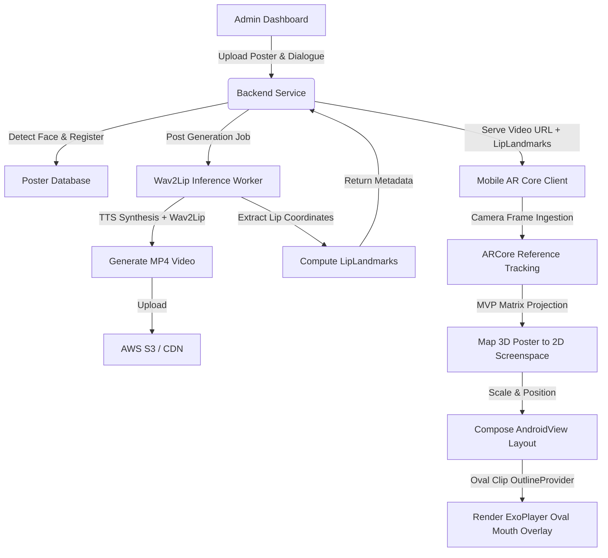

# TalkAR - AR-Powered Talking Head App

An innovative AR-powered mobile application that recognizes images and generates lip-synced talking heads in the user's chosen language, creating immersive interactive experiences.

### 📱 App Demonstrations

| Scan & Video Overlay Demo | Alternative Interaction Demo |
| :---: | :---: |
| [](https://youtube.com/shorts/vpItvAV6yYs) | [](https://youtube.com/shorts/S6mBbW4bXFY) |

## 🎯 App Vision

TalkAR revolutionizes how users interact with static images by bringing them to life through AR technology. When users point their camera at recognized images (posters, advertisements, educational materials), the app generates realistic talking head avatars that speak in their preferred language, creating engaging and personalized experiences.

### Core Value Proposition

- **Immersive AR Experience**: Transform static images into interactive talking heads
- **Multi-language Support**: Break language barriers with real-time translation and voice synthesis
- **Educational & Marketing Applications**: Perfect for museums, retail, education, and advertising
- **Accessibility**: Make content accessible to users with different language preferences

## 🏗️ Project Structure

```
TalkAR/
├── mobile-app/          # Android AR app (Kotlin + ARCore)
│   ├── app/
│   │   ├── src/main/java/com/talkar/app/
│   │   │   ├── data/           # Data layer (API, local DB)
│   │   │   ├── ui/             # UI components and screens
│   │   │   └── viewmodels/     # Business logic
│   │   └── build.gradle        # ARCore + Compose setup
│   └── build.gradle
├── backend/            # Node.js/TypeScript API
│   ├── src/
│   │   ├── config/     # Database configuration
│   │   ├── middleware/ # Auth, validation, error handling
│   │   ├── models/      # Data models
│   │   ├── routes/      # API endpoints
│   │   └── services/    # Business logic services
│   └── package.json
├── admin-dashboard/    # React TypeScript dashboard
│   ├── src/
│   │   ├── components/ # Reusable UI components
│   │   ├── pages/      # Dashboard pages
│   │   ├── services/   # API integration
│   │   └── store/      # Redux state management
│   └── package.json
├── docs/              # Comprehensive documentation
│   ├── API.md         # API documentation
│   └── SETUP.md       # Development setup guide
└── docker-compose.yml # Container orchestration
```

## ✨ Key Features

### Mobile App (Android)

- **AR Image Recognition**: ARCore-powered image detection and tracking
- **Real-time AR Overlay**: Seamless 3D talking head rendering
- **Multi-language Support**: Dynamic language switching
- **Offline Capability**: Cached content for offline usage
- **Modern UI**: Jetpack Compose with Material Design 3

### Backend API

- **RESTful API**: Comprehensive endpoints for image and dialogue management
- **Wav2Lip Integration**: Lip-sync video generation from images and audio
- **Cloud Storage**: AWS S3 integration for media assets
- **Authentication**: JWT-based secure access
- **Analytics**: Usage tracking and insights

### Admin Dashboard

- **Content Management**: Upload and manage images and dialogues
- **Analytics Dashboard**: Usage statistics and insights
- **Multi-language Editor**: Manage content in multiple languages
- **User Management**: Admin access control

## 🛠️ Tech Stack

### Mobile App (Android)

- **Language**: Kotlin
- **AR Framework**: ARCore 1.41.0
- **UI Framework**: Jetpack Compose
- **Networking**: Retrofit 2.9.0 + OkHttp
- **Image Loading**: Coil 2.5.0
- **Architecture**: MVVM with Repository pattern
- **Min SDK**: 24 (Android 7.0)
- **Target SDK**: 34 (Android 14)

### Backend API

- **Runtime**: Node.js 18+
- **Language**: TypeScript 5.3.3
- **Framework**: Express.js 4.18.2
- **Database**: PostgreSQL with Sequelize ORM
- **Authentication**: JWT with bcryptjs
- **File Storage**: AWS S3 SDK
- **Validation**: Joi 17.11.0
- **Security**: Helmet, CORS

### Admin Dashboard

- **Framework**: React 18.2.0 + TypeScript
- **UI Library**: Material-UI 5.15.0
- **State Management**: Redux Toolkit 2.0.1
- **Routing**: React Router DOM 6.20.1
- **Forms**: React Hook Form 7.48.2
- **HTTP Client**: Axios 1.6.2

### External Services

- **Wav2Lip Worker**: Asynchronous lip-sync video generation
- **AWS S3**: Cloud storage for images and videos
- **PostgreSQL**: Primary database
- **Docker**: Containerization and orchestration

## 🚀 Quick Start

### Prerequisites

- Node.js 18+ and npm
- Android Studio (latest version)
- Docker and Docker Compose
- PostgreSQL (or use Docker)
- AWS S3 account

### 1. Clone and Setup

```bash
git clone <repository-url>
cd TalkAR
```

### 2. Environment Configuration

```bash
# Backend environment
cp backend/env.example backend/.env
# Edit backend/.env with your configuration

# Admin dashboard environment
echo "REACT_APP_API_URL=http://localhost:3000/api/v1" > admin-dashboard/.env

# Root environment (for Docker)
cp .env.example .env
# Edit .env with your configuration
```

### 3. Start with Docker (Recommended)

```bash
docker-compose up -d
```

### 4. Manual Development Setup

```bash
# Backend
cd backend && npm install && npm run dev

# Wav2Lip worker
cd backend && npm run dev:wav2lip-worker

# Check worker health
cd backend && npm run check:wav2lip-worker

# Admin Dashboard
cd admin-dashboard && npm install && npm start

# Mobile App
# Open mobile-app/ in Android Studio
```

## 📱 Development Environments

### Android Studio Setup

1. **Install Android Studio** (latest version)
2. **Configure ARCore**:
   - Install ARCore SDK
   - Enable ARCore in project settings
   - Configure device for AR testing
3. **Import Project**: Open `mobile-app/` directory
4. **Sync Dependencies**: Gradle sync will install ARCore and Compose dependencies

### Node.js Backend Setup

1. **Install Node.js 18+**
2. **Install Dependencies**: `npm install`
3. **Database Setup**: Configure PostgreSQL connection
4. **Environment Variables**: Copy `backend/env.example` to `backend/.env`
5. **Development Server**: `npm run dev`
6. **Poster-talk worker**: `npm run dev:wav2lip-worker`
7. **Worker health check**: `npm run check:wav2lip-worker`

### Production Setup

1. Copy `backend/.env.production.example` into your deployment secret store or use it as the source of truth for Kubernetes secrets.
2. Set `NODE_ENV=production` and keep `TALKING_PHOTO_ENABLE_WAV2LIP_FALLBACK=false`.
3. Build and publish `talkar-backend` and `talkar-wav2lip-worker`.
4. Apply the production Kubernetes manifests in order.

### React Dashboard Setup

1. **Install Dependencies**: `npm install`
2. **Environment Configuration**: Set API URL
3. **Development Server**: `npm start`
4. **Access**: http://localhost:3001

### Firebase/Firestore Setup

1. **Create Firebase Project**
2. **Enable Firestore Database**
3. **Configure Authentication**
4. **Update Environment Variables**

## 🧠 Core Architecture & Technical Theory

TalkAR uses a hybrid pipeline that splits heavy AI generation tasks (running asynchronously on self-hosted workers) from real-time AR client-side projection mapping.



### 1. Asynchronous Lip-Sync Generation Pipeline

When a poster is registered or dialogue is updated, the backend initiates the generation workflow:
- **Face & Lip Geometry Ingestion**: The poster is preprocessed using face detection libraries to extract the face bounding box (`posterFaceBox`) and define initial lip boundaries. If no face is detected, the poster is marked ineligible for dynamic overlays.
- **Audio Synthesis**: The dialogue text is synthesized to speech using configured providers (Google Cloud TTS or ElevenLabs) and stored.
- **Wav2Lip Inference**: The Wav2Lip worker (`Dockerfile.wav2lip-worker`) processes the image and audio. It aligns the static face with the generated audio waveforms, synthesizing mouth movements to match the phonemes.
- **LipLandmarks Generation**: Along with the final `talking-photo.mp4`, the worker outputs the precise boundaries (`lipX`, `lipY`, `lipWidth`, `lipHeight`) defining the active mouth region relative to the overall video width and height.

### 2. ARCore Perspective Projection & Matrix Mathematics

To render the mouth overlay seamlessly, the mobile client must project coordinates from the physical 3D world onto the 2D mobile screen:
- **Model-View-Projection (MVP) Matrix**: When ARCore tracks the reference poster, it retrieves the poster's 3D pose in world space. In [TalkingPhotoControllerImpl.kt](file:///Users/ajitreddy/Engineering/Projets/TalkAR/TalkAR%20-/mobile-app/app/src/main/java/com/talkar/app/ar/video/TalkingPhotoControllerImpl.kt), the controller translates the poster's corners and center coordinates into NDC (Normalized Device Coordinates) space using:
  \[
  P_{ndc} = M_{projection} \times M_{view} \times M_{model} \times P_{world}
  \]
- **Viewport Translation**: NDC coordinates (ranging from `-1` to `1`) are mapped to the device's screen pixel dimensions to determine the 2D screen fractions for the poster boundaries and the lip bounding box.
- **Direct Lip Projection**: The relative `lipLandmarks` fetched from the backend are projected directly into screen fractions based on the poster's current skew, rotation, and distance, defining the target dimensions for the Compose layout.

### 3. Jetpack Compose & ExoPlayer Oval Mask Overlay

Rather than overlaying the entire generated video (which would replace the user's real-time view of the physical poster environment), TalkAR uses a hybrid overlay technique:
- **Compose Layout Placement**: The Compose wrapper in [LipSyncVideoOverlay.kt](file:///Users/ajitreddy/Engineering/Projets/TalkAR/TalkAR%20-/mobile-app/app/src/main/java/com/talkar/app/ui/components/LipSyncVideoOverlay.kt) listens to position updates and overlays the Android `PlayerView` matching the exact position (`pvX`, `pvY`) and size of the tracked poster.
- **Oval Outline Clipping**: Inside the Compose `AndroidView`, a `ViewOutlineProvider` is attached to the player view. It uses the dynamic `lipLandmarks` boundaries to set an oval crop mask:
  ```kotlin
  pv.outlineProvider = object : ViewOutlineProvider() {
      override fun getOutline(view: View, outline: Outline) {
          val r = view.tag as? Rect ?: return
          outline.setOval(r.left, r.top, r.right, r.bottom)
      }
  }
  pv.clipToOutline = true
  ```
  This clips out the rest of the video, leaving only the talking lips visible over the physical poster!
- **Anti-Flicker Fade Animation**: To prevent black visual flashes before the ExoPlayer video frame is fully decoded, the overlay starts at `0f` alpha. Once the listener triggers `onRenderedFirstFrame()`, the view fades smoothly to full opacity:
  ```kotlin
  override fun onRenderedFirstFrame() {
      pv.animate().alpha(1f).setDuration(80).start()
  }
  ```

---

## 🔧 API Integration

### Wav2Lip Worker & Lip-Sync Generation

- **Purpose**: Generate lip-synced talking head videos from audio and static images
- **Integration**: Backend API queries a queue or directly forwards work to the Wav2Lip worker service
- **Deployment**: Local or containerized worker service running Wav2Lip inference (`Dockerfile.wav2lip-worker`)
- **Features**: Highly optimized, asynchronous job queuing, automatic cleanup of temporary files

### ARCore Integration & Hybrid Rendering

- **Image Tracking**: Real-time reference image tracking via ARCore
- **Perspective Projection Matrix**: The app translates 3D ARCore reference coordinates into 2D screenspace coordinate bounds (`[left, top, right, bottom]` screen fractions) in [TalkingPhotoControllerImpl.kt](file:///Users/ajitreddy/Engineering/Projets/TalkAR/TalkAR%20-/mobile-app/app/src/main/java/com/talkar/app/ar/video/TalkingPhotoControllerImpl.kt) by computing the model-view-projection (MVP) matrix and projecting 3D points.
- **Direct Lip Projection**: Projects individual lip corners (`lipX`, `lipY`, `lipWidth`, `lipHeight`) through the MVP matrix directly to determine the exact screen bounds for the player overlay.
- **Dynamic Lip-Sync Overlay**: Integrates Media3 ExoPlayer with Jetpack Compose using an Android `PlayerView` (configured in `TextureView` mode) positioned dynamically over the poster. The video is clipped to an oval matching the mouth region via `ViewOutlineProvider.setOval()` in [LipSyncVideoOverlay.kt](file:///Users/ajitreddy/Engineering/Projets/TalkAR/TalkAR%20-/mobile-app/app/src/main/java/com/talkar/app/ui/components/LipSyncVideoOverlay.kt).
- **Smooth Visuals**: Applies fade-in animations when playback begins to prevent visual flicker before the first ExoPlayer frame decodes.
- **Compatibility**: Android 7.0+ (Min SDK 24) with ARCore support

### Cloud Storage

- **AWS S3**: Store images, videos, and assets
- **CDN Integration**: Fast content delivery
- **Security**: Secure access controls

## 🔒 Security Best Practices

### Environment Variables and Secrets Management

This project uses environment variables to manage sensitive configuration data. Never commit actual secrets to the repository.

#### Docker Development

For local development with Docker, use the `.env` file:

1. Copy `.env.example` to `.env`:

   ```bash
   cp .env.example .env
   ```

2. Edit `.env` with your actual values (never commit this file)

3. Docker Compose will automatically load these variables

#### Manual Development

For manual development setup:

1. **Backend**:

   ```bash
   cd backend
   cp env.example .env
   # Edit .env with your configuration
   ```

2. **Frontend**:
   ```bash
   cd admin-dashboard
   echo "REACT_APP_API_URL=http://localhost:3000/api/v1" > .env
   ```

### Secret Rotation

### Production Health Probes (Worker Auth Strict)

For production deployments, use strict worker-auth readiness checks:

- Endpoint: `/health?workerAuthStrict=true`
- `200`: healthy
- `503`: worker-auth thresholds breached (pod should be considered not ready)

Kubernetes example:

```yaml
readinessProbe:
  httpGet:
    path: /health?workerAuthStrict=true
    port: 3000
```

See [Deployment Guide](docs/DEPLOYMENT.md) and [Worker Auth Runbook](docs/WORKER_AUTH_INCIDENT_RUNBOOK.md) for full alerting and incident response setup.

- Rotate JWT secrets periodically
- Rotate AWS credentials using IAM roles where possible
- Change database passwords regularly

## 📚 Documentation

- **[Setup Guide](docs/SETUP.md)**: Comprehensive development setup
- **[API Documentation](docs/API.md)**: Complete API reference
- **Architecture**: MVVM pattern with clean separation
- **Deployment**: Docker-based containerization

## 🎯 Phase 1 Deliverables ✅

- ✅ **Repository Structure**: Monorepo with organized folders
- ✅ **Tech Stack Definition**: Complete technology specifications
- ✅ **Development Environments**: Setup guides for all platforms
- ✅ **Documentation**: Comprehensive README and setup guides
- ✅ **Project Architecture**: Clean, scalable code organization

## 🚀 Enhanced AR Development Roadmap

### Current Status (Week 1)

- ✅ **TalkAR Enhanced Development Branch**: Created and ready
- ✅ **AR Components**: Multiple AR implementations ready for testing
- ✅ **Backend Integration**: Complete API system functional
- ✅ **Device Testing**: Samsung A35 ready for development

### Week 1 Deliverables

- [ ] **Device Setup**: Samsung A35 connected and tested
- [ ] **AR Component Testing**: All existing AR components verified
- [ ] **Performance Baseline**: AR performance metrics established
- [ ] **Documentation**: Enhanced AR development roadmap documented

### Upcoming Enhanced Features (Weeks 2-8)

- **3D Avatar System**: Interactive 3D avatars with full body movement
- **Voice Commands**: Natural language processing and voice recognition
- **Product Interaction**: AR shopping and product manipulation
- **High-Fidelity Rendering**: Photorealistic 3D rendering with advanced lighting
- **Mobile Optimization**: Enhanced ARCore stability and offline caching

## 🔄 Next Steps

Ready for Enhanced AR Development Phase

- Test existing AR components on Samsung A35
- Implement 3D avatar system
- Add voice command integration
- Develop product interaction features
- Optimize AR performance for production
