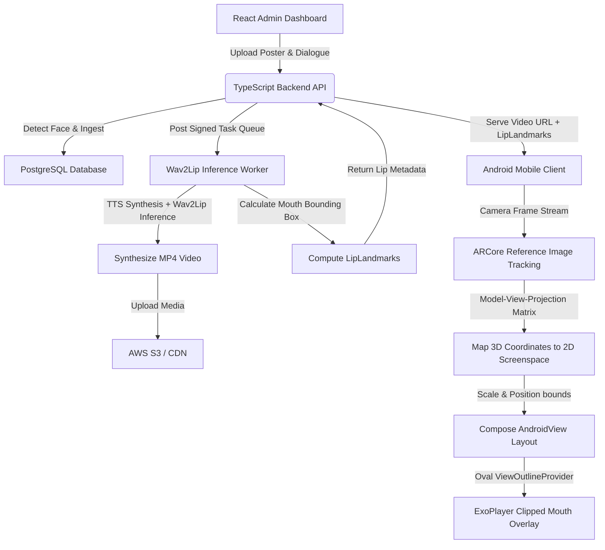

# TalkAR — AR-Powered Talking Head App 🚀

TalkAR is a production-grade, end-to-end Augmented Reality (AR) application that recognizes static images (such as posters or educational materials) in the physical world and overlays a realistic, dynamic, lip-synced talking head video on top of them. 

By splitting heavy AI processing (running asynchronously on self-hosted inference workers) from the real-time AR projection client (running on Android via ARCore and Media3 ExoPlayer), TalkAR creates a seamless and interactive multi-language conversational overlay.

---

### 📱 App Demonstrations

| Scan & Video Overlay Demo | Alternative Interaction Demo |
| :---: | :---: |
| [](https://youtube.com/shorts/vpItvAV6yYs) | [](https://youtube.com/shorts/S6mBbW4bXFY) |

---

## 🏗️ System Architecture & Data Flow

TalkAR uses a hybrid pipeline that decouples asynchronous heavy video generation from real-time client-side rendering.



### Core Execution Flow:
1. **Content Ingestion**: Admin uploads a poster and dialogue script via the React Dashboard.
2. **Preprocessing**: The backend validates the poster image and extracts the face bounding box (`posterFaceBox`).
3. **Synthesis**: The backend posts a signed request to the Wav2Lip worker. The worker synthesizes speech from the script (via Google TTS/ElevenLabs) and runs the Wav2Lip neural model to animate the mouth.
4. **Metadata Extraction**: The worker outputs the final talking video along with relative mouth coordinates (`LipLandmarks`).
5. **AR Scanning**: The Android client detects the physical poster using ARCore's reference image database.
6. **Dynamic Rendering**: ExoPlayer downloads/caches the talking video. The client projects the mouth coordinate bounds using 3D perspective projection, drawing a cropped oval video overlay directly over the static physical poster.

---

## 💻 Repository Structure & Components

```
TalkAR/
├── mobile-app/          # Android client (Kotlin, Jetpack Compose, ARCore)
│   ├── app/
│   │   ├── src/main/java/com/talkar/app/
│   │   │   ├── data/           # Repository pattern & Room DB local cache
│   │   │   ├── ui/             # Jetpack Compose screens, ViewModels, and overlays
│   │   │   └── ar/             # ARCore session control & matrix calculations
│   │   └── build.gradle        # Media3 ExoPlayer & ARCore configurations
├── backend/            # Express.js + TypeScript Orchestrator API
│   ├── src/
│   │   ├── config/     # Database, Groq, Ollama, S3 configurations
│   │   ├── middleware/ # Token validation, strict HMAC worker auth, error handling
│   │   ├── models/      # Sequelize definitions (Poster, Dialogue, Artifact, User)
│   │   ├── routes/      # Endpoints (images, dialogues, analytics, settings, scripts)
│   │   └── services/    # Business services (aiPipeline, talkingPhotoArtifact)
│   ├── Dockerfile       # Container definition for backend API
│   └── Dockerfile.wav2lip-worker # Inference container runner setup
├── admin-dashboard/    # React + TypeScript Dashboard (Redux Toolkit, Material-UI)
│   ├── src/
│   │   ├── components/ # Poster upload forms, dialogue editors, live monitors
│   │   ├── pages/      # Images, dialogues, analytics, AI configs, settings
│   │   └── store/      # Redux global state stores
└── k8s/                # Kubernetes Deployment configuration templates
```

---

## 🧠 Core Technical Concepts & Mathematics

### 1. ARCore 3D-to-2D Perspective Projection
To position the lip video overlay correctly, the Android client translates 3D coordinate vertices of the physical poster in space to 2D device screen coordinates. 

In [TalkingPhotoControllerImpl.kt](file:///Users/ajitreddy/Engineering/Projets/TalkAR/TalkAR%20-/mobile-app/app/src/main/java/com/talkar/app/ar/video/TalkingPhotoControllerImpl.kt), the reference poster's 3D pose retrieved from ARCore is multiplied by the Model-View-Projection (MVP) matrix to find the Normalized Device Coordinates (NDC) point:

\[
P_{ndc} = M_{projection} \times M_{view} \times M_{model} \times P_{world}
\]

Where:
* \(M_{model}\) converts poster local coordinates to world coordinates.
* \(M_{view}\) maps world coordinates to camera coordinates.
* \(M_{projection}\) applies camera perspective mapping.

These NDCs (ranging from `-1` to `1`) are scaled to pixels relative to the screen dimensions to establish the layout bounding box for the player.

### 2. Jetpack Compose & ExoPlayer Oval Masking
Instead of drawing the entire video frame (which would block out the physical surroundings), TalkAR uses a hybrid compositing trick. In [LipSyncVideoOverlay.kt](file:///Users/ajitreddy/Engineering/Projets/TalkAR/TalkAR%20-/mobile-app/app/src/main/java/com/talkar/app/ui/components/LipSyncVideoOverlay.kt), a custom Android `PlayerView` (ExoPlayer in `TextureView` mode) is mapped to cover the tracked poster. It clips the player view using the relative `lipLandmarks` boundaries:

```kotlin
pv.outlineProvider = object : ViewOutlineProvider() {
    override fun getOutline(view: View, outline: Outline) {
        val r = view.tag as? Rect ?: return
        outline.setOval(r.left, r.top, r.right, r.bottom)
    }
}
pv.clipToOutline = true
```

#### Anti-Flicker Protection:
TextureView displays a black box momentarily while the video decodes. To prevent a black oval flashing over the face, the video overlay has `alpha = 0f` initially and fades in smoothly within 80ms upon first frame rendering:

```kotlin
override fun onRenderedFirstFrame() {
    pv.animate().alpha(1f).setDuration(80).start()
}
```

### 3. Local Video Caching with Integrity Checks
The Android client embeds a Room database video cache (`VideoCacheImpl.kt`) to store synthesized videos locally.
* **Integrity Validation**: Computes a SHA-256 fingerprint on downloaded videos to verify they match backend metadata.
* **Cache Eviction**: Uses an LRU (Least Recently Used) policy with a strict 500MB size limit and a 24-hour time-to-live (TTL) expiration window to keep local storage clean.

### 4. Signed Worker HMAC-SHA256 Authentication
To protect the self-hosted Python Wav2Lip worker from unauthorized requests, the backend API signs all task request bodies with an HMAC-SHA256 signature (`buildWorkerAuthHeaders` in the backend middlewares). The worker validates the signature payload and prevents request execution if the timestamp skew exceeds 5 minutes (`WAV2LIP_WORKER_MAX_SKEW_MS`).

---

## 🚀 Quick Start Guide

### 1. One-Click Setup with Docker (Recommended)
You can boot the database, backend orchestration API, React admin dashboard, and Wav2Lip worker using the root Docker Compose file:

1. Copy `.env.example` to `.env`:
   ```bash
   cp .env.example .env
   ```
2. Configure S3, Database, and API keys inside `.env`.
3. Start the containers:
   ```bash
   docker-compose up -d
   ```

### 2. Manual Development Setup

#### Backend Orchestrator API
```bash
cd backend
cp env.example .env  # Update with your S3, PostgreSQL, Groq, and TTS credentials
npm install
npm run dev
```

#### Wav2Lip Python worker (Run locally)
```bash
cd backend
npm run dev:wav2lip-worker  # Runs the Python queue listener worker on port 8088
```

#### React Admin Dashboard
```bash
cd admin-dashboard
echo "REACT_APP_API_URL=http://localhost:3000/api/v1" > .env
npm install
npm start  # Runs on http://localhost:3001
```

#### Android Mobile Client
1. Open the `/mobile-app` directory in Android Studio.
2. Ensure your physical testing device supports ARCore and has **Google Play Services for AR** installed.
3. Sync Gradle and run the `:app` module on your connected device.

---

## 🔒 Production Readiness & Monitoring

* **Strict Worker-Auth Health Probes**: The backend routes container health checks to `/health?workerAuthStrict=true`. It returns `200` only if both the orchestrator and the Wav2Lip queue listener are authenticating and ready, throwing `503` otherwise.
* **Secret Key Rotation**: All JWT and worker HMAC signature credentials can be safely rotated by updating the secret store env files without causing downtime.

---

## 🧪 Testing Suite Validation

Both the backend and mobile projects are fully covered by automated regression testing suites.

* **Backend Tests (Express/Jest)**: Tests compilation checks (`tsc --noEmit`) and integration endpoints using `--runInBand` database execution:
  ```bash
  cd backend
  npm run test
  ```
* **Android Tests (Kotest Property Testing)**: Includes 32 property test scenarios verifying `BackendVideoFetcher` polling, exponential backoff, Room database cache evictions, and coordinate projection algorithms:
  ```bash
  cd mobile-app
  ./gradlew test --no-daemon
  ```
